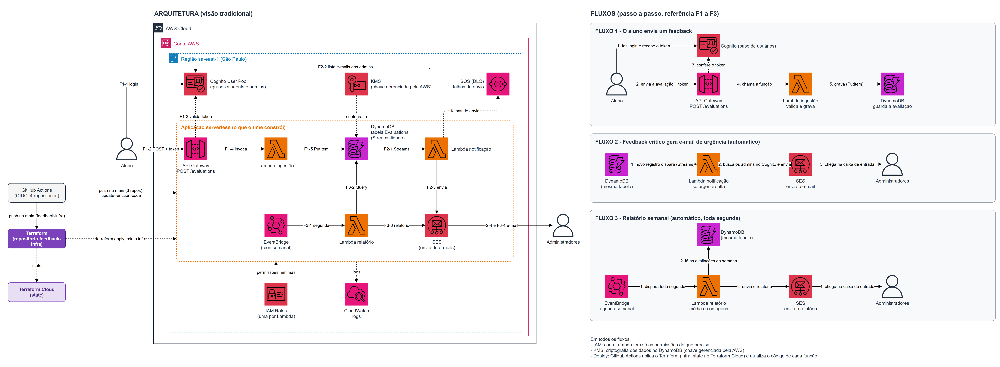

# feedback-lambda-report

**Weekly report** Lambda for the Class Feedback Platform — Tech Challenge phase 4, serverless architecture on AWS.

Students submit `POST /evaluations` with `{"description": string, "score": int 0..10}`.
Administrators receive an urgent-feedback email (low scores) and a weekly report.

## The 4 repositories

| Repository | Responsibility |
|---|---|
| [feedback-infra](https://github.com/biadevcosta/feedback-infra) | Terraform for all infrastructure |
| [feedback-lambda-ingestion](https://github.com/biadevcosta/feedback-lambda-ingestion) | Receives the evaluation and writes it to DynamoDB |
| [feedback-lambda-notification](https://github.com/biadevcosta/feedback-lambda-notification) | Notifies admins by email when urgency is high |
| **feedback-lambda-report** (this one) | Generates and sends the weekly report |

## Architecture



Diagram source: [`docs/architecture.drawio`](https://github.com/biadevcosta/feedback-infra/blob/main/docs/architecture.drawio) in feedback-infra.

## What it does

Triggered by **EventBridge** every Monday at 08:00 Brasília time (`cron(0 11 ? * MON *)`, UTC). It reads the previous 7 complete days (Monday to Sunday) from the `by-day` index, builds the report and emails it to the members of the Cognito `admins` group through SES.

- **Function:** `feedback-report` · Java 21 · 512 MB · `sa-east-1`
- **Permissions:** `dynamodb:Query` on the `by-day` index only (no Scan), `cognito-idp:ListUsersInGroup`, `ses:SendEmail`
- **Environment variables:** `TABLE_NAME`, `INDEX_NAME`, `USER_POOL_ID`, `ADMIN_GROUP`, `SES_SENDER`, `DAYS`

### Report content

- Average score of the period (one decimal place)
- Number of evaluations per day and per urgency level
- List with description, urgency and submission date

The email is sent even when the week had no evaluations, so admins know the report ran. One email per admin, only to verified addresses.

## Code structure

Hexagonal architecture (ports and adapters), enforced by ArchUnit tests.

```
com.feedback.report
├── ReportHandler            # Lambda entry point
├── domain/                  # ReportPeriod, WeeklyReport, WeeklyReportCalculator, ReportEmailRenderer
├── application/             # SendWeeklyReportUseCase and output ports
├── adapter/in/scheduler/    # EventBridge event → command (report period)
├── adapter/out/dynamodb/    # One Query per day on the by-day index
├── adapter/out/cognito/     # AdminDirectory on Cognito
├── adapter/out/ses/         # EmailSender on SES
└── config/                  # Environment variables and dependency wiring
```

## Build and test

```bash
./mvnw verify
```

Unit tests mock DynamoDB, Cognito and SES (no AWS calls). The build fails below **80% coverage** (JaCoCo) and produces the shaded jar in `target/`.

## Pipeline

`.github/workflows/ci-cd.yml`:

- **Pull request:** build and test.
- **Push to `main`:** build, test and publish the jar with `aws lambda update-function-code`, authenticated through GitHub OIDC (no static AWS keys). The role, `feedback-github-lambda-report`, can only update this function's code.

Required GitHub variable: `AWS_ROLE_ARN` (output `function_pipeline_role_arns` of `feedback-infra`).

**LGPD:** logs contain only ids and counts, never email addresses or the description.
